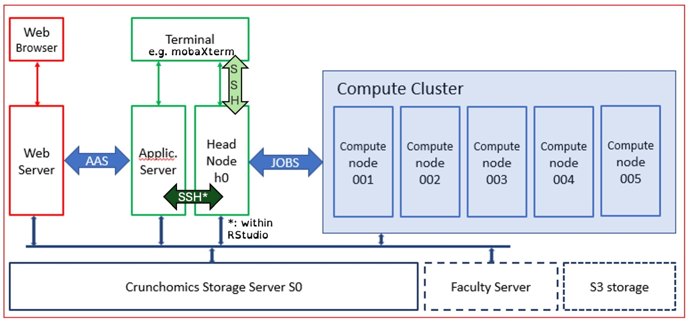

To start this tutorial, make sure you're connected to the Crunchomics headnode `h0` as discussed in the [computational setup episode](../part0-setup/01_setup.qmd). As always, let's organize ourselves. Navigate to your `personal/MDA` directory, then create a new directory for todays tutorial: `mkdir genome-assembly`. Navigate into it and create a `data/` directory:

```bash
cd personal/MDA/
mkdir genome-assembly
cd genome-assembly/
mdir data
```

## Using the compute nodes

Remember the Crunchomics diagram?



So far, we only worked on the `Head Node h0`. Today, you will learn how to use the compute nodes of Crunchomics by submitting `JOBS`. Crunchomics uses `slurm`, a program to manage all the jobs submitted to the cluster by all the users. 

### Submitting your first slurm job

To submit a job, we must write a little script. In the RStudio editor, click File, New File, Shell script. Add the following contents. Use the little numbers to get an explanation per line.

```bash
#!/bin/bash
#SBATCH --job-name=sleep_demo          # <1>
#SBATCH --time=00:02:00                # <2>
#SBATCH --cpus-per-task=1              # <3>
#SBATCH --mem=100M                     # <3>

# The actual job commands start here
echo "Job $SLURM_JOB_ID started on $(hostname) at $(date)" # <4>
sleep 75                               # <5>
echo "Job finished at $(date)"
```

1. The name of the job
2. Time limit; `slurm` kills the job if it runs longer.
3. Resource requests: one CPU and 100 MB of memory.
4. `$SLURM_JOB_ID` is set by Slurm inside the job.
5. The actual "work": just wait 75 seconds.

Save this file as `run_sleep.sh` in your `genome-assembly` folder. In your terminal, verify that it exists:

```bash
(base) [mpaauw@omics-h0 genome-assembly]$ ls
data  sleep_test.sh # it exists!
```

Then, you submit the job like this:

```bash
sbatch sleep_test.sh
```

You will see that the job is submitted, and is assigned a job ID. For the rest nothing seems to happen, but your job is no longer running at the headnode `h0`, instead it's running on one of the compute nodes. We can look at all the jobs that are currently running or waiting on the compute nodes by looking at the Slurm queue like this:

```bash
squeue
```

Depending on if the cluster is very busy, this can give a long list of queued or running jobs. Can you find yours, by the job name or your student number? On which of the compute nodes is it running?

Remember, you can use command line tricks to filter this output if it's confusing. For example, we can filter the jobs that are actually running (`R`) from jobs that are waiting to start (pending; `PD`):

```bash
squeue | grep R
```

(Alternatively, you could `grep` for your student number to see only your jobs.)

While (or after) your jobs is running, a log file is created.

```bash
(base) [mpaauw@omics-h0 genome-assembly]$ ls
data  sleep_test.sh  slurm-387072.out
```

In my case it's called `slurm-387072.out`. Inspect it using `cat` to see the contents. Discuss with your neighbour or teacher what you see. Do the same after your job has finished running (which should take about.... 75 seconds!).

## Getting the data

We are now ready to assemble a genome! To assemble a genome, we need reads. For this tutorial, the reads are stored on a shared drive on Crunchomics. There are different read datasets, and the teacher will assign to you which dataset you should copy to your working directory. Some datasets contain long Nanopore reads, while other datasets contain short Illumina reads. In addition, different subsets of the data were made by the teaching team: resulting in low and high sequencing depth datasets. 

Copy your read dataset into to the `data` directory in your work directory. Important! replace the `AXY` with the dataset number! The format of the datasets is `A01` to `B10`. The `B` datasets are paired-end, they have `_1` or `_2` in their filenames. Use the wildcard symbol `*` to catch them both when copying.

```bash
cp /zfs/omics/projects/education/MDA/MDA-materials/genome-assembly/datasets/dataset_AXY*.fastq data/
```

Note that we will be working with real datasets in this tutorial. Some commands (including just copying the data) may take a while.

::: {.callout-caution collapse="false" title="Exercise"}
Investigate the read set. Find out the following parameters:

1. How many reads do you have?
2. How many total basepairs do you have? Assuming a 5 million basepair bacterial genome, what is the sequencing depth? 2b: which assumption we are making to answer the latter question?
3. What is the size distribution of your dataset (minimum, average, and maximum read length)? 3b: which sequencing platorm was likely used (`Illumina` or `Nanopore`)?
4. Add this information to this to this [Google Sheet](https://docs.google.com/spreadsheets/d/1ARB0ZgmnG-mSbV5gqsJOfApGxxUxZHZ4i7HYs34aAPU/edit?usp=sharing){target="_blank"}, at the correct dataset number. Also add your initials to the table.

```{bash}
#| eval: false
#| code-fold: true
#| code-summary: "Click me to see the answer"

# 1. and 2. and 3. 
# We need to run one command to find out everything that is asked
seqkit stats data/dataset_AXY.fastq

# 2b: we are assuming that all reads actually come from the organism of interest.
# 2b: if our read set would be contaminated (with e.g. human DNA), the coverage (or depth) of our bacterium of interest would be lower.

# 3b:
# A shortread dataset has many reads that are short, with a high total sequencing depth.
# A longread dataset has fewer reads, with a wide distribution of lengths, and a low sequencing depth.
```
:::

Depending on if you have Illumina data or Nanopore data, you will need a different assembly tool. Also, the structure of the output files will look different. Note: in contrast to the RNA-seq tutorial, this tutorial uses *real* datasets, and the assembly jobs may take a while! Remember from the lecture, assembling a human genome with longread data takes more than 2000 computer-hours! To speed things up, bioinformatics tools can often use more threads at the same time. In this tutorial, we will ask the tools to use a modest amount of threads, since we are sharing the headnode with eachother (and other researchers of IBED and SILS).

So, head over to the correct section, and start your genome assembly job.

## `megahit`: assembly for short reads

If you have short reads, make a `assemble-megahit.sh` script like this. This is for dataset `B05`, replace with your number!

```bash
#!/bin/bash
#SBATCH --job-name=megahit-assembly
#SBATCH --time=01:00:00 
#SBATCH --cpus-per-task=6 
#SBATCH --mem=16G #

megahit -1 data/dataset_B05_1.fastq -2 data/dataset_B05_2.fastq \
    -o megahit-assembly -t 6
```

Note that we tell `slurm` that we need more power: 1 hour (it will be done faster!), 6 CPUs, and 16G of RAM memory. In the `megahit` command, we specificy that we have 'paired end reads' (`-1` and `-2`), that we want to store the results in a new folder (`-o megahit-assembly`) and that `megahit` can use 6 threads (`-t 6`).

Save your script, in the `genome-assembly` folder. Then, submit the job:

```bash
sbatch assemble-megahit.sh
```

This will take a while. Monitor your job by inspecting the slurm queue (`squeue`) every now and then: is your job still running? Also, inspect the log file (`slurm-xxxx.out`) every now and then. This will be filled with a lot of information from the megahit run. You don't have to read and understand everything but you can try to see if you understand some parts.

Finished? Even though the job was run on the compute nodes, the results will be in your own directory. Let's have a look at the output by listing the contents of the output directory:

```bash
ls megahit-assembly
```

There's a subfolder called `intermediate_contigs`, which contains a lot of intermediate files. We don't need them today (although you can look at them if you want). The important files are:

- `final.contigs.fasta`: the actual genome assembly
- `log`: the full log file of the `megahit` run. There's a lot of info, but some useful results can be found at the very end of the file.

Take a moment to inspect the files with your toolkit of unix commands (`cat`, `head`, `tail`, `seqkit`, etc).

## `flye`: assembly for long reads

If you have long reads, make a `assemble-flye.sh` script like this. This is for datset `A06`, replace with your number!

```bash
#!/bin/bash
#SBATCH --job-name=flye-assembly
#SBATCH --time=01:00:00 
#SBATCH --cpus-per-task=6 
#SBATCH --mem=16G #

flye --nano-raw data/dataset_A06.fastq --genome-size 5M \
    --out-dir flye-assembly --threads 6

```

Note that we tell `slurm` that we need more power: 1 hour (it will be done faster!), 6 CPUs, and 16G of RAM memory. In the `flye` command, we point to the raw nanopore reads (`--nano-raw`), that we want to store the results in a new folder (`--out-dir flye-assembly`) and that `flye` can use 6 threads (`--threads 6`).

Save your script, in the `genome-assembly` folder. Then, submit the job:

```bash
sbatch assemble-flye.sh
```

This will take a while. Monitor your job by inspecting the slurm queue (`squeue`) every now and then: is your job still running? Also, inspect the log file (`slurm-xxxx.out`) every now and then. This will be filled with a lot of information from the megahit run. You don't have to read and understand everything but you can try to see if you understand some parts.

Finished? Even though the job was run on the compute nodes, the results will be in your own directory. Let's have a look at the output by listing the contents of the output directory:

```bash
ls flye-assembly/
```

There are 5 subfolders which contain a lot of intermediate files. We don't need them today (although you can look at them if you want). Important files are:

- `assembly.fasta`: the actual genome assembly
- `assembly_info.txt`: small text file with info of each contig
- `flye.log`: the full log file of the `flye` run. There's a lot of info, but some useful results can be found at the very end of the file.

Take a moment to inspect the files with your toolkit of unix commands (`cat`, `head`, `tail`, `seqkit`, etc).

## Gathering assembly statistics in `google sheets`

::: {.callout-caution collapse="false" title="Exercise"}
Gather the following information of your genome assembly:

- Total assembly length
- Number of contigs
- N50 of contig lengths
- Minimum contig length
- Maximum contig length
- Average coverage (approximately)

You can use `seqkit stats` on your assembly, in combination with looking at log files of your assembly job, to obtain this information.

Add the information to your row in the [Google Sheet](https://docs.google.com/spreadsheets/d/1ARB0ZgmnG-mSbV5gqsJOfApGxxUxZHZ4i7HYs34aAPU/edit?usp=sharing){target="_blank"}.

```{bash}
#| eval: false
#| code-fold: true
#| code-summary: "Click me to see the answer"

# Again, we would get nearly all statistics with seqkit stats:
seqkit stats flye-assembly/assembly.fasta

# for both flye and megahit, the N50 can be found in the end of the log file
tail megahit-assembly/log 
tail flye-assembly/flye.log
```
:::

If you're fast, you can make another assembly. Look in the google sheet to find out which datasets are still available. Make sure to organise your results well by giving each output folder a sensible name.

## Comparing assembly strategies

Together with your colleagues, you created a number of assemblies of the same bacterial isolate. We can now make a a sensible comparison about assembly quality between short and long reads, with different sequencing depths. You can import the data stored in the google sheet to an R session with the following code:

```R
library(readr)

assembly_data <- read_csv(
    "https://docs.google.com/spreadsheets/d/1ARB0ZgmnG-mSbV5gqsJOfApGxxUxZHZ4i7HYs34aAPU/export?format=csv"
)

# ... add code to make your plot :)
```

If you're here early, make sure to repeat the data import later when your colleagues entered more data to the google sheet. 

::: {.callout-caution collapse="false" title="Assignment"}
:exclamation:*Mini Assignment*:exclamation:

Make a figure that compares the most important (according to you) assembly statistic(s) across:

- Different sequencing technologies
- Different sequencing depths

Think carefully about how you organise your figure so that your main message becomes easy to see. Perhaps, first sketch what you want to visualize. You may use multiple panels if this makes your comparisons more clear (but it's not required). Think back to the data visualisation tutorial and try make a figure that uses good data visualisation practices.

When you are done, come to one of the teachers (Misha or Tijs) to discuss your plot. You'll briefly explain your figure to the teacher. This assignment will not be graded, but you need to `pass` this assignment. To pass, you need to show that you understand your figure and can clearly explain the main patterns you observe, including the effects of sequencing technology and sequencing depth on assembly quality. If your explanation is unclear or incomplete, we will give you feedback and ask you to continue working on your plot. You can then try the explanation again.

:::

## Genome annotation

If there's time left, you can annotate your genome. There are numerous command-line programs available to annotate all sorts of interesting features on bacterial genomes. However, these are not pre-installed on Crunchomics and in this tutorial, we will not learn how to install new softwares. Luckily, some annotation tools also have webservers available. To use these, download the assembly to your local computer.

Then, follow your favorite of the following options:

- [Bakta](https://bakta.computational.bio): general genome annotation, the successor of `prokka`
- [antiSMASH](https://antismash.secondarymetabolites.org/#!/start): annotation of biosynthetic gene clusters
- [proksee](https://proksee.ca): a genome browser service with many embedded annotation options (e.g. `bakta` and `prokka`, but also specialized annotation tools for mobile genetic elements like `PHASTEST` (bacteriophages) and `mobileOG-db` (different types of mobile genetic elements))

Inspect the results, discuss them with your neighbour and/or teacher!


